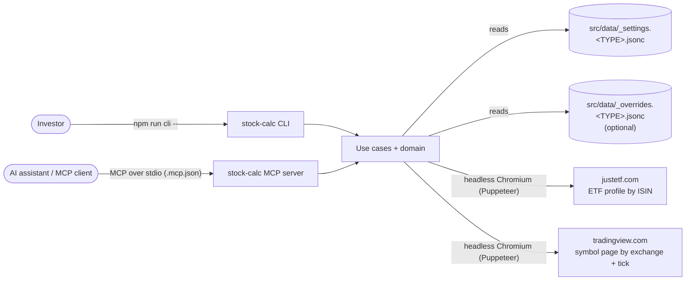
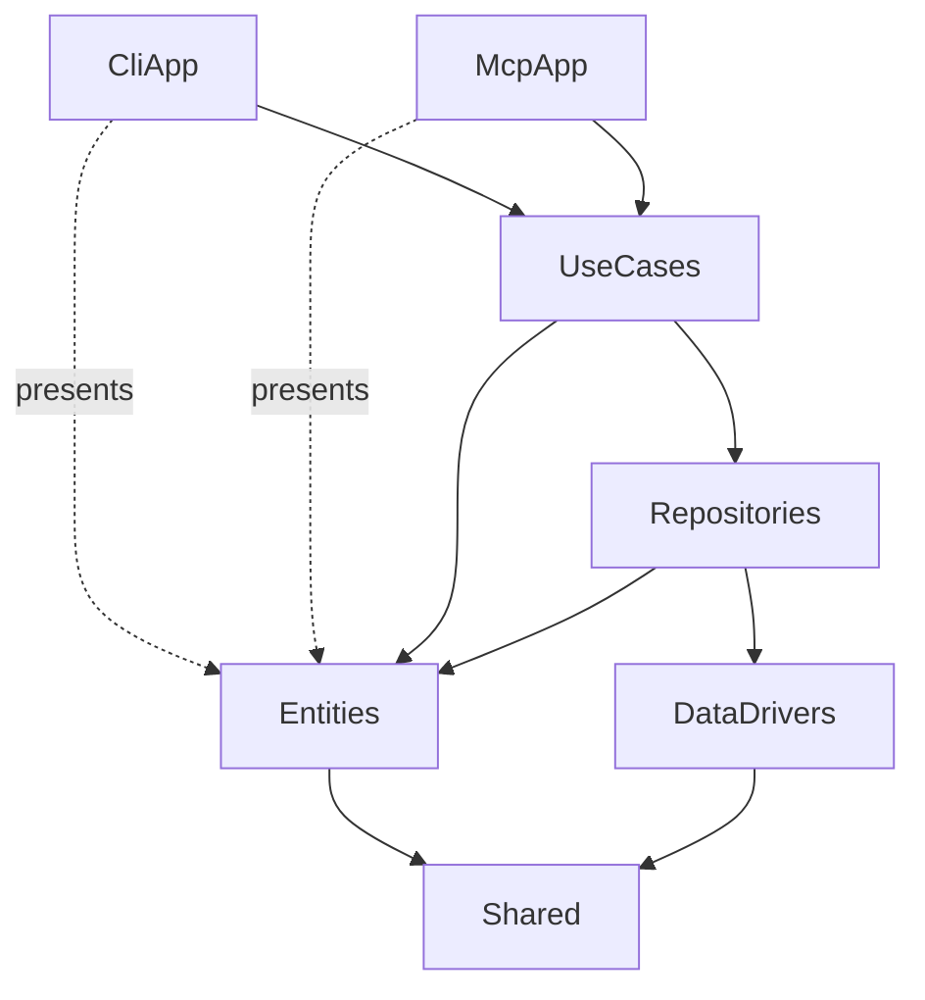
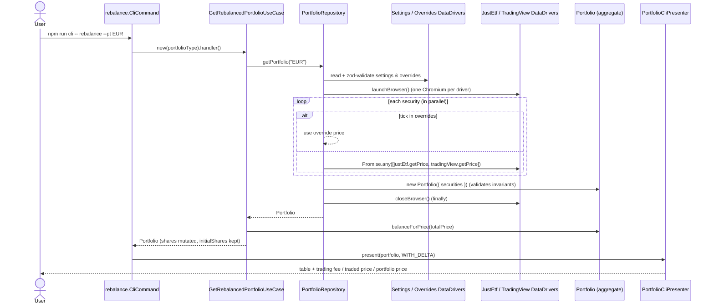

# Architecture Overview

## Purpose and scope

stock-calc is a single-user, local, read-only portfolio calculator with two interfaces: a **CLI** for people and an **MCP server** for AI assistants. It loads a portfolio definition from a local file, gets the current price of each security, and calculates share counts that bring the portfolio to its target allocation. It also reports the trades and fees needed to get there.

It **does not** place orders, store history, or write back to the portfolio file. After trading, the user updates `shares` in the settings file by hand.

## System context

| External system | Used for | Lookup key | Notes |
| --- | --- | --- | --- |
| justetf.com | ETF quotes | `isin` | Only works for securities with an ISIN. 2 s selector timeout. |
| tradingview.com | Any listed symbol | `exchange` + `tick` | 30 s selector timeout. |
| Local JSONC files | Portfolio definition and price overrides | Portfolio type (`--pt`/`--portfolio` or the `portfolio` tool input, default `EUR`) | Git-ignored. Only `*.example` files are tracked. |
| MCP clients (Claude Code, …) | Calling the use cases as tools | Tool name | Configured by the project's `.mcp.json`. |

## Layers

The code uses a layered "clean architecture" split ([ADR-0002](adr/0002-layered-clean-architecture.md)). Each folder under `src/` is one layer:

| Layer | Folder | Responsibility | May depend on |
| --- | --- | --- | --- |
| Interface (CLI) | `src/CliApp` | Parse arguments (commander), call a use case, render results and errors (chalk, `console.table`). | UseCases, Entities (for presenting), Shared |
| Interface (MCP) | `src/McpApp` | Expose each use case as an MCP tool (`@modelcontextprotocol/sdk`, zod schemas). Return structured results or tool errors ([ADR-0014](adr/0014-mcp-server-interface.md)). | UseCases, Entities (for presenting), Shared |
| Application | `src/UseCases` | One class per user intent. Loads the portfolio and applies a domain operation. | Repositories, Entities, Shared |
| Repository | `src/Repositories` | Builds the `Portfolio` aggregate from settings, overrides, and live prices. Acts as the anti-corruption layer between DTOs and the domain. | DataDrivers, Entities |
| Infrastructure | `src/DataDrivers` | Reads and validates files (zod), scrapes web pages. Returns plain DTOs. | Shared, external libraries |
| Domain | `src/Entities` | `Portfolio`, `PortfolioSecurity`, and `Security`: invariants, valuation, fees, rebalancing math. | Shared, `decimal.js`, `class-validator` |
| Shared kernel | `src/Shared` | Browser lifecycle base class, validation helper and error type, numeric and object utilities. | External libraries |

The two interface layers never import each other. Each has its own options file and presenters.

### Where the dependency rule is relaxed

The layering is a convention. It is not strictly inverted:

- There is **no dependency injection**. Each use case creates a concrete `PortfolioRepository`, and the repository creates concrete data drivers. Tests replace them with module mocks (`vi.mock`, [ADR-0015](adr/0015-vitest-with-coverage-gate.md)).
- The port interface `IPriceDataDriver`, the DTO types, and the zod schemas they're derived from live in `src/DataDrivers`, not in an application or domain layer.
- `minimal.CliCommand.ts` and `minimal.McpTool.ts` import default constants (`DEFAULT_ACCEPTABLE_PRECESION`, `DEFAULT_SHARES_STEP`) from their use case.

## Runtime flow

Every command and tool follows the same path. CLI `rebalance` is shown here; the MCP `rebalance` tool differs only in the first and last steps.

Over MCP, the client calls the `rebalance` tool with `{ "portfolio": "EUR" }`. The SDK validates the input against the tool's zod schema, and `PortfolioMcpPresenter` returns `structuredContent` (plus the same JSON as text) instead of printing a table.

### Price resolution

For each security, independently and in parallel ([ADR-0006](adr/0006-race-multiple-price-sources.md), [ADR-0008](adr/0008-manual-price-overrides.md)):

1. If the security's `tick` is a key in the overrides file, that `{ price, currency }` is used and no scraping happens.
2. Otherwise both scrapers run concurrently with `Promise.any`. The first one that resolves wins.
3. If both reject, `Promise.any` rejects with an `AggregateError`, and the presenter shows each driver's error. Each driver error keeps the underlying Puppeteer error as its `cause`.

Both browsers are launched before any price is fetched, but only if at least one security isn't overridden. They are closed, and awaited, in a `finally` block. Pages are never closed individually, because a page may still be in use by the losing driver; closing the browser cleans them up.

### Error handling

Each CLI action and each MCP tool handler is wrapped in `try/catch` and passes any error to its interface's error presenter. `ErrorCliPresenter` prints to stderr. `ErrorMcpPresenter` returns a tool result with `isError: true`. Both handle:

- `AggregateError`: each inner error is presented recursively.
- `ClassValidatorError`: a domain validation failure. Each violated property's constraints are listed, including nested children (as tables in the CLI, as indented lines over MCP).
- Any other `Error`: its name and message.

Invalid input is rejected as early as possible, in three stages:

- **CLI arguments:** commander parsers reject non-numeric numbers and invalid portfolio names with a usage error (exit code 1).
- **MCP input:** the SDK rejects input that fails a tool's zod schema before any use case runs.
- **Use cases:** they validate their parameters and throw `ClassValidatorError` for out-of-range values.

When a command fails, the CLI prints the error and exits with code 1.

## Data and configuration

- **Portfolio type** (`--pt, --portfolio <type>` in the CLI, `portfolio` in MCP tools, default `EUR`; letters, digits, `_` and `-` only, see `src/Shared/portfolioName.ts`) selects `src/data/_settings.<TYPE>.jsonc` and `src/data/_overrides.<TYPE>.jsonc`. Paths are resolved relative to the `DataDrivers` source folder through `import.meta.dirname`.
- Files are JSONC (comments allowed), parsed with `jsonc-parser`, and validated at runtime with zod schemas in `src/DataDrivers/DataFiles.schema.ts` ([ADR-0007](adr/0007-local-jsonc-portfolio-files.md), [ADR-0012](adr/0012-validate-data-files-with-zod.md)). The DTO types are derived from those schemas. The fields are documented in the [README](../../README.md#portfolio).
- `.mcp.json` registers the MCP server for this project (stdio, `node node_modules/tsx/dist/cli.mjs src/McpApp/app.ts`).

## Technology

| Concern | Choice | Decision |
| --- | --- | --- |
| Runtime / modules | Node 22 (`.nvmrc`), native ESM (`"type": "module"`) | [ADR-0013](adr/0013-node22-esm-toolchain.md) |
| Language | TypeScript 6 (type-check only, `noEmit`; `module: preserve`, `moduleResolution: bundler`) | [ADR-0013](adr/0013-node22-esm-toolchain.md) |
| Execution | `tsx`, no build output | [ADR-0013](adr/0013-node22-esm-toolchain.md) |
| CLI | `commander` 15 + `@commander-js/extra-typings` | |
| MCP | `@modelcontextprotocol/sdk` (stdio transport) | [ADR-0014](adr/0014-mcp-server-interface.md) |
| Arithmetic | `decimal.js` | [ADR-0003](adr/0003-decimal-arithmetic.md) |
| Domain validation | `class-validator` decorators (`experimentalDecorators`) | [ADR-0004](adr/0004-self-validating-entities.md) |
| File and tool-input validation | `zod` 4 | [ADR-0012](adr/0012-validate-data-files-with-zod.md) |
| Price scraping | `puppeteer` 25 (headless Chromium) | [ADR-0005](adr/0005-scrape-prices-with-headless-browser.md) |
| CLI output | `console.table`, `chalk` | |
| Tests | Vitest 5, v8 coverage, ≥ 95% gate | [ADR-0015](adr/0015-vitest-with-coverage-gate.md) |
| Lint / style | ESLint 10 flat config: `typescript-eslint`, `@stylistic`, `import-x`. No semicolons, 100-character lines | [ADR-0013](adr/0013-node22-esm-toolchain.md) |

## Quality attributes and constraints

- **Correctness of money math:** all valuation uses `Decimal`. Share counts are integers.
- **Network and scraping fragility:** prices depend on third-party HTML (CSS selectors such as `#realtime-quotes .val` and `[data-symbol="EX:TICK"] .js-symbol-last`). Layout changes on those sites break price lookup. Overrides are the manual fallback.
- **Performance:** each run or tool call that needs a live price launches two Chromium instances (none when every price is overridden). Runtime is dominated by page loads and the TradingView timeout. The MCP server itself starts in about a second.
- **Protocol hygiene:** the MCP server must never write to stdout. `src/McpApp/app.ts` redirects console output to stderr.
- **Testability:** layers are isolated in tests with module mocks. No test uses a real browser, the network, or `src/data`.
- **Statelessness:** nothing is persisted between runs.

## Extension points

| To add… | Do this |
| --- | --- |
| A use case | Extend `PortfolioUserCase`, implement `handler()`, and end the constructor with `validateClassErrors(this, Self)` if it has validated parameters. Expose it through **both** interfaces (next two rows). |
| A CLI command | Add `src/CliApp/CliCommands/<name>.CliCommand.ts` with the shared `portfolioOption` and a `try/catch` that calls `ErrorCliPresenter`, register it in `src/CliApp/app.ts`, and add a `cli:<name>` npm script. |
| An MCP tool | Add `src/McpApp/McpTools/<name>.McpTool.ts` exporting `register<Name>Tool(server)` with a zod `inputSchema` (spread `portfolioInput`), `outputSchema: portfolioOutputSchema`, `portfolioToolAnnotations`, and a `try/catch` that returns `ErrorMcpPresenter.present(e)`. Register it in `src/McpApp/server.ts`. |
| A price source | Implement `IPriceDataDriver` (usually by extending `BrowserController`), then add it to the repository's driver list and launch/close calls. |
| A portfolio | Create `src/data/_settings.<NAME>.jsonc` (and optionally `_overrides.<NAME>.jsonc`), then run with `--pt <NAME>` or call a tool with `"portfolio": "<NAME>"`. |
