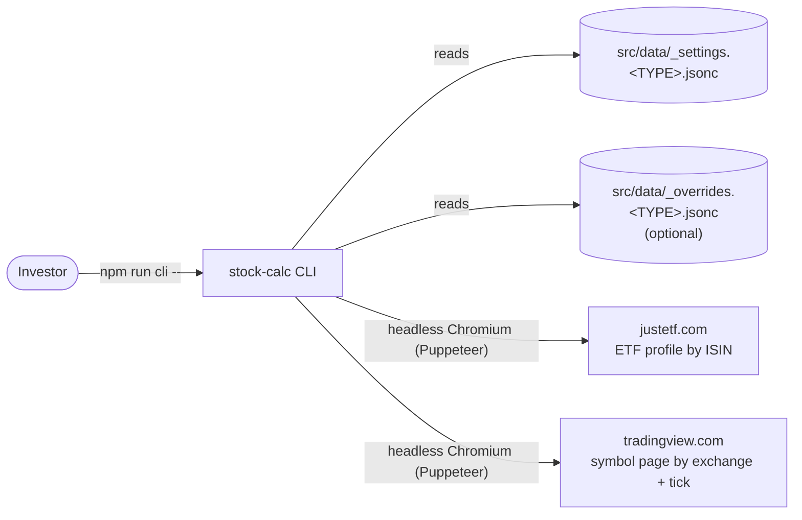
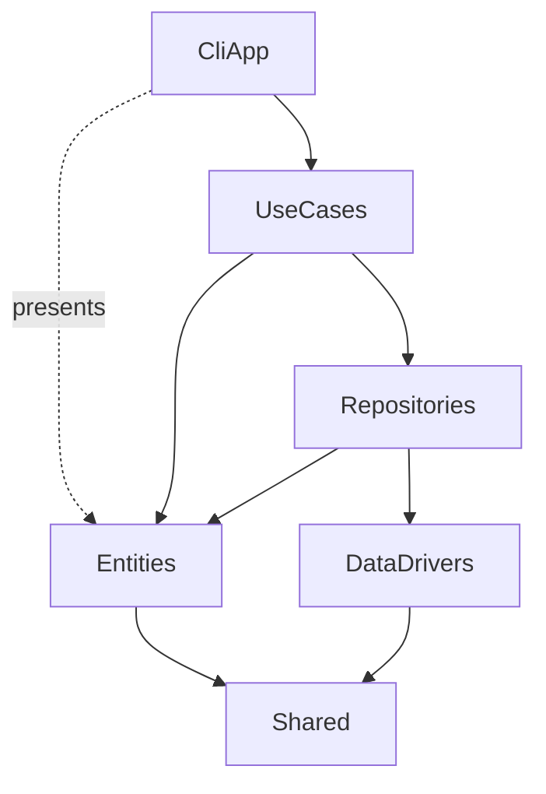
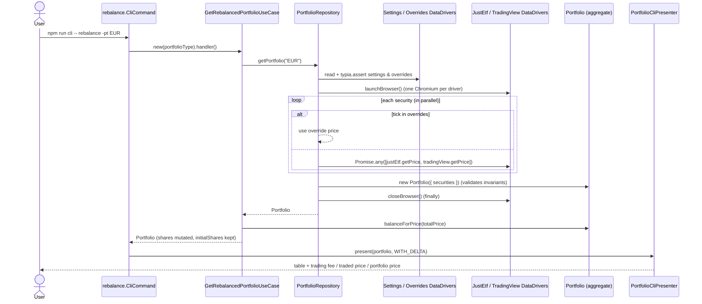

# Architecture Overview

## Purpose and scope

stock-calc is a single-user, local, read-only CLI. It loads a portfolio definition from a local file, gets the current price of each security, and calculates share counts that bring the portfolio to its target allocation. It also reports the trades and fees needed to get there.

It **does not** place orders, store history, or write back to the portfolio file. After trading, the user updates `shares` in the settings file by hand.

## System context

| External system | Used for | Lookup key | Notes |
| --- | --- | --- | --- |
| justetf.com | ETF quotes | `isin` | Only works for securities with an ISIN. 2 s selector timeout. |
| tradingview.com | Any listed symbol | `exchange` + `tick` | 30 s selector timeout. |
| Local JSONC files | Portfolio definition and price overrides | Portfolio type (`--portfolio`, default `EUR`) | Git-ignored. Only `*.example` files are tracked. |

## Layers

The code uses a layered "clean architecture" split ([ADR-0002](adr/0002-layered-clean-architecture.md)). Each folder under `src/` is one layer:

| Layer | Folder | Responsibility | May depend on |
| --- | --- | --- | --- |
| Interface (CLI) | `src/CliApp` | Parse arguments (commander), call a use case, render results and errors (chalk, `console.table`). | UseCases, Entities (for presenting), Shared |
| Application | `src/UseCases` | One class per user intent. Loads the portfolio and applies a domain operation. | Repositories, Entities, Shared |
| Repository | `src/Repositories` | Builds the `Portfolio` aggregate from settings, overrides, and live prices. Acts as the anti-corruption layer between DTOs and the domain. | DataDrivers, Entities |
| Infrastructure | `src/DataDrivers` | Reads files and scrapes web pages. Returns plain DTOs. | Shared, external libraries |
| Domain | `src/Entities` | `Portfolio`, `PortfolioSecurity`, and `Security`: invariants, valuation, fees, rebalancing math. | Shared, `decimal.js`, `class-validator` |
| Shared kernel | `src/Shared` | Browser lifecycle base class, validation helper and error type, numeric and object utilities. | External libraries |

### Where the dependency rule is relaxed

The layering is a convention. It is not strictly inverted:

- There is **no dependency injection**. Each use case creates a concrete `PortfolioRepository`, and the repository creates concrete data drivers. Substituting a fake repository or driver (for example, in tests) means changing code.
- The port interface `IPriceDataDriver` and the DTOs (`SettingsDto`, `SecurityPriceDto`) live in `src/DataDrivers/IPriceDataDriver.type.ts`, not in an application or domain layer.
- `minimal.CliCommand.ts` imports default constants (`DEFAULT_ACCEPTABLE_PRECESION`, `DEFAULT_SHARES_STEP`) from its use case.

## Runtime flow

Every command follows the same path. `rebalance` is shown here:

### Price resolution

For each security, independently and in parallel ([ADR-0006](adr/0006-race-multiple-price-sources.md), [ADR-0008](adr/0008-manual-price-overrides.md)):

1. If the security's `tick` is a key in the overrides file, that `{ price, currency }` is used and no scraping happens.
2. Otherwise both scrapers run concurrently with `Promise.any`. The first one that resolves wins.
3. If both reject, `Promise.any` rejects with an `AggregateError`. `ErrorCliPresenter` unpacks it and prints each driver's error.

Both browsers are launched before any price is fetched, even if every price comes from overrides. They are closed in a `finally` block. Pages are never closed individually, because a page may still be in use by the losing driver; closing the browser cleans them up.

### Error handling

Each command action is wrapped in `try/catch` and sends any error to `ErrorCliPresenter.present`. It handles:

- `AggregateError`: each inner error is presented recursively.
- `ClassValidatorError`: a domain validation failure. The constraints of each violated property (and of nested children) are printed as tables.
- Any other `Error`: its name and message.

Errors are printed but the process **still exits with code 0**.

## Data and configuration

- **Portfolio type** (`-pt, --portfolio <type>`, default `EUR`) selects `src/data/_settings.<TYPE>.jsonc` and `src/data/_overrides.<TYPE>.jsonc`. Paths are resolved relative to the `DataDrivers` source folder through `__dirname`.
- Files are JSONC (comments allowed), parsed with `jsonc-parser`, and checked against TypeScript types at runtime with `typia.assert` ([ADR-0007](adr/0007-local-jsonc-portfolio-files.md)).
- Schemas: `SettingsDto` / `SettingsSecurityDto` and `Record<tick, SecurityPriceDto>`, in `src/DataDrivers/IPriceDataDriver.type.ts`. The fields are documented in the [README](../../README.md#portfolio).

## Technology

| Concern | Choice | Decision |
| --- | --- | --- |
| Language / runtime | TypeScript 5 on Node (`.nvmrc`: 16.16.0; needs Node 15+ for `Promise.any`) run through `ts-node`, no build output | [ADR-0009](adr/0009-run-typescript-directly-with-ts-node.md) |
| CLI | `@commander-js/extra-typings` | |
| Arithmetic | `decimal.js` | [ADR-0003](adr/0003-decimal-arithmetic.md) |
| Domain validation | `class-validator` decorators | [ADR-0004](adr/0004-self-validating-entities.md) |
| File validation | `typia` (compile-time transform through `ts-patch`) | [ADR-0007](adr/0007-local-jsonc-portfolio-files.md) |
| Price scraping | `puppeteer` (headless Chromium) | [ADR-0005](adr/0005-scrape-prices-with-headless-browser.md) |
| Output | `console.table`, `chalk` | |
| Lint / style | ESLint (airbnb-base + airbnb-typescript), no semicolons, 100-character lines | |

## Quality attributes and constraints

- **Correctness of money math:** all valuation uses `Decimal`. Share counts are integers.
- **Network and scraping fragility:** prices depend on third-party HTML (CSS selectors such as `#realtime-quotes .val` and `[data-symbol="EX:TICK"] .js-symbol-last`). Layout changes on those sites break price lookup. Overrides are the manual fallback.
- **Performance:** each run launches two Chromium instances. Runtime is dominated by page loads and the TradingView timeout.
- **Testability:** there are no automated tests, and the lack of dependency injection makes unit tests of use cases and the repository hard to write without changing code.
- **Statelessness:** nothing is persisted between runs.

## Extension points

| To add… | Do this |
| --- | --- |
| A CLI command | Add `src/CliApp/CliCommands/<name>.CliCommand.ts` with the shared `portfolioOption` and a `try/catch` that calls `ErrorCliPresenter`, register it in `src/CliApp/app.ts`, and add a `cli:<name>` npm script. |
| A use case | Extend `PortfolioUserCase`, implement `handler()`, and end the constructor with `validateClassErrors(this, Self)` if it has validated parameters. |
| A price source | Implement `IPriceDataDriver` (usually by extending `BrowserController`), then add it to the repository's driver list and launch/close calls. |
| A portfolio | Create `src/data/_settings.<NAME>.jsonc` (and optionally `_overrides.<NAME>.jsonc`), then run with `-pt <NAME>`. |
