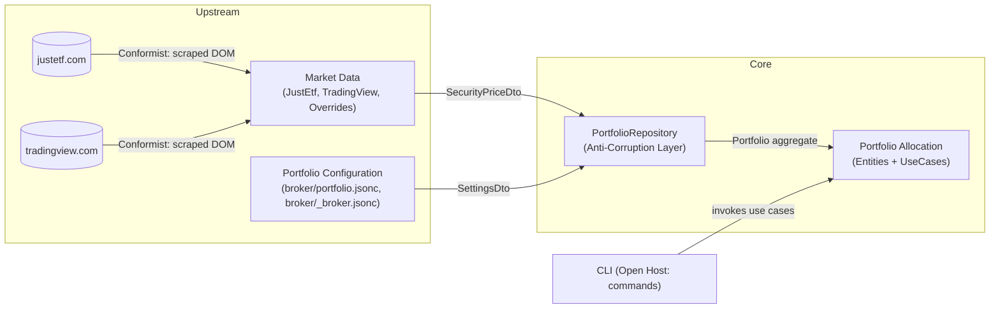
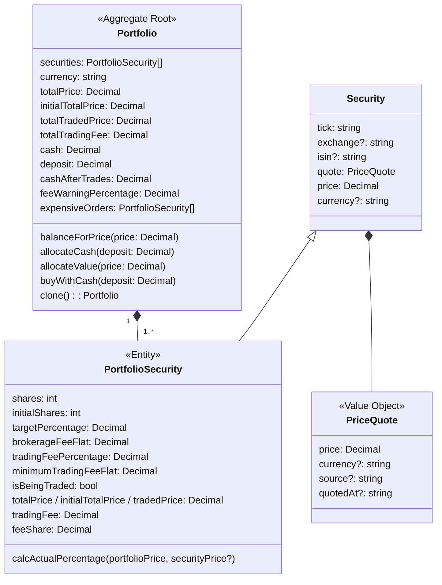

# Domain Overview

## Problem space

An individual investor holds a **portfolio** of exchange-traded **securities** (ETFs and stocks), each with a desired **target percentage** of the portfolio's value. Market prices move, so actual weights drift away from targets. Shares are also bought in whole units, and every order costs fees. The investor needs to answer questions like:

- *What do I hold now, and how far is it from my targets?* (`show`)
- *What trades bring me back to my targets?* (`rebalance`)
- *I have X more to invest. What should I buy?* (`invest`)
- *What would an allocation worth exactly X look like?* (`target`)
- *What is the smallest set of whole shares that matches my targets within a tolerance?* (`minimal`)

The system answers these questions as **plans**. It never executes trades.

## Subdomains

| Subdomain | Type | Why |
| --- | --- | --- |
| **Portfolio allocation and trade planning** | Core | The reason the tool exists: turning targets, prices, and holdings into whole-share allocations, trades, and fees. |
| **Market data (pricing)** | Generic | Getting a security's current price and currency. A commodity problem, solved by scraping third-party sites. |
| **Portfolio configuration** | Supporting | Defining which securities a portfolio holds, current shares, targets, and broker fees. Stored in local files. |

## Bounded contexts

| Bounded context | Responsibility | Code | Docs |
| --- | --- | --- | --- |
| **Portfolio Allocation** | Domain model and rules: aggregate, invariants, valuation, fees, allocation algorithms. | `src/Entities`, `src/UseCases` | [portfolio-allocation.md](portfolio-allocation.md), [use-cases.md](use-cases.md) |
| **Market Data** | Turns a security identity (tick + exchange, or ISIN) into a price quote, with manual overrides. | `src/DataDrivers/{JustEtf,TradingView,Overrides}.DataDriver.ts`, `src/Shared/BrowserController.abstract.ts` | [market-data.md](market-data.md) |
| **Portfolio Configuration** | Loads and validates the portfolio definition (holdings, targets, fees). | `src/DataDrivers/Settings.DataDriver.ts`, `src/data/*.jsonc` | [portfolio-allocation.md § Configuration](portfolio-allocation.md#configuration-portfolio-definition) |

The **CLI** (`src/CliApp`) is an interface layer, not a bounded context. It translates commands into use-case calls and renders the aggregate.

## Context map

- **Market Data conforms** to the external sites: it has no influence over their markup and reads whatever they render.
- **`PortfolioRepository` is the anti-corruption layer.** It is the only place where DTOs (`SettingsDto`, `SecurityPriceDto`) are translated into domain objects (`Portfolio`, `PortfolioSecurity`). The domain never sees DTOs, file paths, or browser objects.
- **Shared kernel:** `src/Shared` (validation helper, rounding utilities, browser base class) is used across contexts.

## Domain model at a glance

See [ubiquitous-language.md](ubiquitous-language.md) for the meaning of each term.
