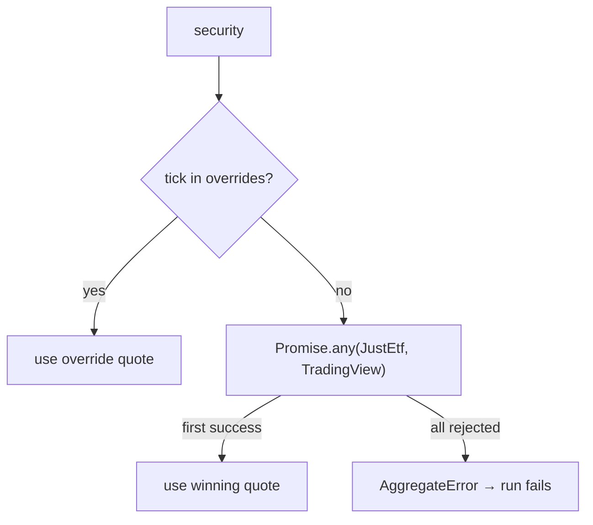

# Market Data (generic bounded context)

This context answers one question: **what is the current price and currency of this security?** It supports the core domain, but nothing about it is specific to portfolio allocation.

Code: `src/DataDrivers/{JustEtf,TradingView,Overrides}.DataDriver.ts`, `src/DataDrivers/IPriceDataDriver.type.ts`, `src/Shared/BrowserController.abstract.ts`, and the `getPrice` method of `src/Repositories/Portfolio.Repository.ts`.

## Model

| Concept | Shape | Notes |
| --- | --- | --- |
| **Security identity** (lookup request) | `SettingsSecurityDto`: `tick`, `exchange`, `isin?` (plus `shares` and `targetPercentage`, which drivers ignore) | Each source uses a different part of the identity. |
| **Price quote** | `SecurityPriceDto`: `{ price: number, currency: string }` | A value object: no identity, no timestamp, no record of its source. |
| **Price source** | `IPriceDataDriver.getPrice(identity) → Promise<PriceQuote>` | Rejects when the source can't price the security. |
| **Price override** | `Record<tick, PriceQuote>` from `_overrides.<TYPE>.jsonc` | Per portfolio type. Optional file. |

## Sources

| Source | Identity used | How | Fails when |
| --- | --- | --- | --- |
| **JustEtf** | `isin` | Loads `justetf.com/en/etf-profile.html?isin=<ISIN>` and reads `#realtime-quotes .val` (text `"<CUR> <price>"`). | No ISIN in settings, or no quote within 2 s. |
| **TradingView** | `exchange` + `tick` | Loads `tradingview.com/symbols/<EXCHANGE>-<TICK>/` and reads `.js-symbol-last` and `.js-symbol-currency` under `[data-symbol="<EXCHANGE>:<TICK>"]`. | Symbol unknown, or nothing visible within 30 s. |
| **Override** | `tick` | Lookup in the overrides map. | Never: it either matches or doesn't apply. |

## Resolution policy

1. **Overrides take precedence** over live sources ([ADR-0008](../architecture/adr/0008-manual-price-overrides.md)).
2. **Live sources race** with each other. The first success wins; there's no priority order ([ADR-0006](../architecture/adr/0006-race-multiple-price-sources.md)).
3. **One unpriceable security fails the whole run.** The aggregate can't be built without every price.

All securities are resolved in parallel (`Promise.all` in the repository).

## Translation into the core domain

`PortfolioRepository` is the **anti-corruption layer**. It merges each `SettingsSecurityDto` with its `SecurityPriceDto` and the portfolio's fee settings into an `IPortfolioSecurity`, then builds the `PortfolioSecurity` and `Portfolio` entities. From then on the core domain sees only `Decimal` prices and validated entities, never DTOs, URLs, or browsers.

The quote's `currency` becomes `Security.currency`. The core then enforces the **single-currency invariant**, so the currency strings from different sources and overrides have to match exactly (for example `"EUR"` from both).

## Operational notes

- One headless Chromium per live source per run, launched before resolution and closed afterwards, even when every price is overridden.
- Selectors depend on third-party markup. When a site changes its layout, prices for that source fail. Add overrides until the driver is fixed.
- Adding a source: implement `IPriceDataDriver` (extend `BrowserController` if it needs a browser), add an instance to the repository, add it to the `priceDataDrivers` list, and add it to the `launchBrowser` / `closeBrowser` calls.

## Known gaps

Current behaviour, pinned by tests with `// Current behaviour:` comments:

1. **Scraped values aren't validated.** If a selector matches nothing or holds no text, the quote is `NaN` or `0` (TradingView gives `price: 0, currency: null`) instead of an error. Prices with thousands separators (`1,234.56`) parse as `NaN`.
2. **Page-load failures aren't wrapped.** `page.goto` runs outside the drivers' `try`, so a navigation error surfaces as a raw Puppeteer error, not as "not registered".
3. **Concurrent `launchBrowser()` calls start two browsers**, and the first one is never closed. The repository launches each driver once, so this doesn't happen today.
4. **The portfolio type isn't sanitised.** It goes straight into the file path, so `../` segments can escape `src/data`. This is acceptable for a local single-user tool, but worth fixing before exposing the MCP server more widely.
5. **JSONC syntax errors are tolerated.** `jsonc-parser` recovers from them (for example a stray `,,`), so a malformed file may still validate. An empty overrides file fails validation, while a missing one means no overrides.
6. **The file schemas only check types.** Ranges (non-negative shares, percentages ≤ 1) are enforced later by the entities.
