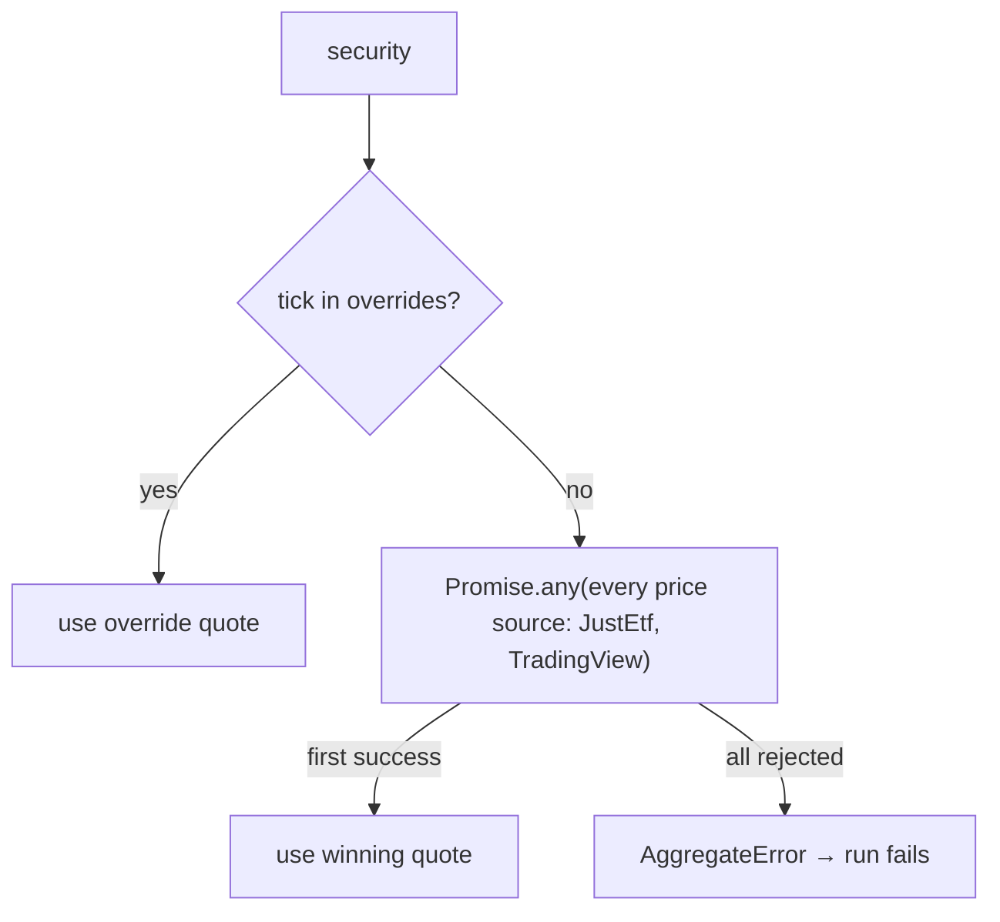

# Market Data (generic bounded context)

This context answers one question: **what is the current price and currency of this security?** It supports the core domain, but nothing about it is specific to portfolio allocation.

Code: `src/DataDrivers/{JustEtf,TradingView,Overrides}.DataDriver.ts`, `src/DataDrivers/DataDrivers.type.ts`, `src/Shared/BrowserController.abstract.ts`, and the `getPrice` method of `src/Repositories/Portfolio.Repository.ts`.

## Model

| Concept | Shape | Notes |
| --- | --- | --- |
| **Security identity** (lookup request) | `SettingsSecurityDto`: `tick`, `exchange`, `isin?` (plus `shares` and `targetPercentage`, which drivers ignore) | Each source uses a different part of the identity. |
| **Price quote** | `SecurityPriceDto`: `{ price: number, currency: string }` | A value object: no identity, no timestamp, no record of its source. |
| **Price source** | `IPriceDataDriver.getPrice(identity) → Promise<PriceQuote>` | Rejects when the source can't price the security. |
| **Price override** | `Record<tick, PriceQuote>` from `_overrides.<TYPE>.jsonc` | Per portfolio type. Optional file. |

## Sources

| Source | Identity used | How | Fails when |
| --- | --- | --- | --- |
| **JustEtf** | `isin` | Loads `justetf.com/en/etf-profile.html?isin=<ISIN>` and reads `#realtime-quotes .val` (text `"<CUR> <price>"`). | No ISIN in settings, navigation fails, no quote within 2 s, or the text isn't a valid quote. |
| **TradingView** | `exchange` + `tick` | Loads `tradingview.com/symbols/<EXCHANGE>-<TICK>/` and reads `.js-symbol-last` and `.js-symbol-currency` under `[data-symbol="<EXCHANGE>:<TICK>"]`. | Navigation fails, symbol unknown, nothing visible within 30 s, or the text isn't a valid quote. |
| **Override** | `tick` | Own-key lookup (`Object.hasOwn`) in the overrides map. | Never: it either matches or doesn't apply. |

**Scraped quotes are validated** by `parsePriceQuote` (`src/DataDrivers/PriceQuote.parser.ts`). Whitespace (including non-breaking spaces) and thousands commas are stripped, the price must be a plain positive decimal, and the currency must not be empty. Otherwise the source rejects with its "not registered" error, with the parse error (`No price text found`, `Price '<text>' is not a positive number`, `No currency text found`) as `cause`.

## Resolution policy

1. **Overrides take precedence** over live sources ([ADR-0008](../architecture/adr/0008-manual-price-overrides.md)).
2. **Live sources race** with each other. The first success wins; there's no priority order ([ADR-0006](../architecture/adr/0006-race-multiple-price-sources.md)).
3. **One unpriceable security fails the whole run.** The aggregate can't be built without every price.

All securities are resolved in parallel (`Promise.all` in the repository).

## Translation into the core domain

`PortfolioRepository` is the **anti-corruption layer**. It merges each `SettingsSecurityDto` with its `SecurityPriceDto` and its fees (each part the security doesn't set falls back to the portfolio's) into an `IPortfolioSecurity`, then builds the `PortfolioSecurity` and `Portfolio` entities. From then on the core domain sees only `Decimal` prices and validated entities, never DTOs, URLs, or browsers.

The quote's `currency` becomes `Security.currency`. The core then enforces the **single-currency invariant**, so the currency strings from different sources and overrides have to match exactly (for example `"EUR"` from both).

## Operational notes

- One headless Chromium per live source per run. They are launched together, only when at least one security isn't overridden, and closed (awaited) afterwards, whether or not the load succeeded. When a load fails, a browser that also fails to close doesn't replace the load's error. Concurrent `launchBrowser()` calls share one in-flight launch.
- Selectors depend on third-party markup. When a site changes its layout, prices for that source fail. Add overrides until the driver is fixed.
- Adding a source: implement `IPriceDataDriver` (extend `BrowserController` if it needs a browser), then add an instance to the `prices` list in `src/compositionRoot.ts`. The repository launches, races and closes every source it is given ([ADR-0018](../architecture/adr/0018-dependency-injection-and-composition-root.md)).

## Data file validation

Portfolio files are read through `src/DataDrivers/DataFiles.reader.ts`:

- **Portfolio names** must match `/^[A-Za-z0-9_-]+$/`. Otherwise reading fails with `Invalid portfolio name '<type>': use letters, digits, '_' or '-'`, so a name can't escape `src/data`.
- **JSONC syntax errors** fail with `Invalid data file '<path>': JSONC syntax error: <Code> at <line>:<col>` (trailing commas are allowed). An empty or comments-only overrides file means no overrides. An empty settings file is an error.
- **Schemas check ranges**, not just types: no unknown keys in the settings file (so a misspelled fee isn't silently ignored), non-empty tick, exchange and currency, integer shares ≥ 0, target and fee percentages in [0, 1], non-negative flat fees, override prices > 0. Mistakes are reported with the file path and field path before any entity is built.

## Known gaps

- **Race winner is nondeterministic.** When both sources succeed, the faster one wins, and they may differ slightly in price or currency formatting (ADR-0006).
- **No quote timestamp or source** is recorded on the price quote.
