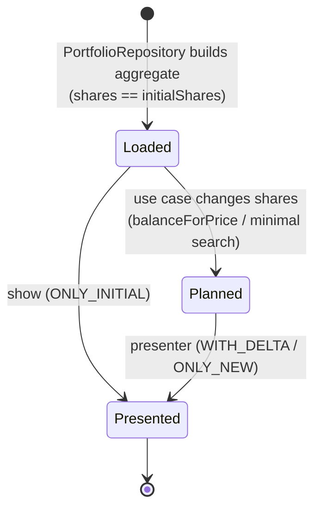

# Portfolio Allocation (core bounded context)

This context owns the rules for valuing a portfolio, measuring drift from target weights, computing whole-share allocations, and costing the trades between current and proposed holdings.

Code: `src/Entities` (model) and `src/UseCases` (application services; see [use-cases.md](use-cases.md)).

## Central idea: a portfolio is a plan

A `Portfolio` instance holds **two states at once** ([ADR-0010](../architecture/adr/0010-track-initial-state-in-entities.md)):

- the **initial** state, `initialShares`: what the investor holds now, fixed at construction, and
- the **proposed** state, `shares`: what the investor should hold, changed by use cases.

Everything about trades (traded shares, trade value, fees) is the difference between the two states. Prices are the same in both states, because a plan is made at a single point in time.



## Aggregate: `Portfolio`

**Aggregate root.** It's the only object use cases load and return, and it owns its `PortfolioSecurity` entities.

| Member | Meaning |
| --- | --- |
| `securities` | The holdings: one or more `PortfolioSecurity`. |
| `currency` | The single currency shared by all securities (taken from the first). |
| `totalPrice` | Σ security `totalPrice`: the value of the proposed state. |
| `initialTotalPrice` | Σ security `initialTotalPrice`: the value of current holdings. |
| `totalTradedPrice` | `totalPrice − initialTotalPrice`: net cash needed (positive) or released (negative). |
| `totalTradingFee` | Σ security `tradingFee`: the cost of all orders. |
| `balanceForPrice(price)` | **Domain operation.** For each security: `shares = round(price × targetPercentage ÷ securityPrice)` (rounded half-up by `Decimal.round()`). Throws `Portfolio price must be a finite number of at least 0 (<price>)` before changing anything if `price` is NaN, infinite or negative. |
| `clone()` | Deep copy through constructors, which re-validates. Not used by any command at the moment. |

### Invariants (checked at construction)

The constructor assigns the fields, runs decorator validation (P1, P4), then checks P2, P3 and P5 in that order.

| # | Invariant | Enforced by | Failure |
| --- | --- | --- | --- |
| P1 | At least one security | `@IsArray() @ArrayNotEmpty()` | `ClassValidatorError` (`arrayNotEmpty` on `securities`) |
| P2 | Target percentages sum to **exactly** 1 (`Decimal` equality) | constructor | `Error: Portfolio percentage don't add up to 1 (<sum>)` |
| P3 | All securities have the same currency | constructor | `Error: Portfolio have securities with different currencies` |
| P4 | Each security is itself valid | `@ValidateNested()` + each entity's own validation | `ClassValidatorError` |
| P5 | Ticks are unique | constructor | `Error: Portfolio has duplicate ticks (<ticks>)` |

## Entity: `PortfolioSecurity`

A holding of one security within a portfolio. It extends `Security`, so it carries the identity and the price quote. Its practical identity within the aggregate is its **tick**.

| Member | Meaning |
| --- | --- |
| `shares` / `initialShares` | Proposed and current whole-share counts. `initialShares` defaults to `shares`. |
| `targetPercentage` | Target weight in [0, 1]. |
| `brokerageFeeFlat`, `tradingFeePercentage`, `minimumTradingFeeFlat` | The portfolio's broker fee settings, copied onto each security. |
| `isBeingTraded` | `shares !== initialShares` |
| `totalPrice` / `initialTotalPrice` | `price × shares` / `price × initialShares` |
| `tradedPrice` | `totalPrice − initialTotalPrice` (signed: + buy, − sell) |
| `tradingFee` | See [fee model](#fee-model). |
| `calcActualPercentage(portfolioPrice, securityPrice = totalPrice)` | `securityPrice ÷ portfolioPrice`. Returns 0 instead of NaN when both are 0. |

### Invariants

| # | Invariant | Enforced by |
| --- | --- | --- |
| S1 | `shares`, `initialShares` are integers ≥ 0 | `@IsInt() @Min(0)` |
| S2 | `0 ≤ targetPercentage ≤ 1` | `@Min(0) @Max(1)` on getter |
| S3 | `brokerageFeeFlat ≥ 0`, `minimumTradingFeeFlat ≥ 0` | `@Min(0)` on getters |
| S4 | `0 ≤ tradingFeePercentage ≤ 1` | `@Min(0) @Max(1)` on getter |
| S5 | `tick` not empty, `price ≥ 0` | inherited from `Security` |

## `Security`

The tradable instrument plus its price at plan time: `tick`, `exchange?`, `isin?`, `price` (`Decimal`, ≥ 0), and `currency?`. It's never created directly, only as the base of `PortfolioSecurity`.

Conceptually it combines two things: an **instrument identity** (tick, exchange, ISIN), which would be a value object, and a **price quote** (price, currency), which is also a value object. The code doesn't separate them.

## Fee model

Per security (one order per traded security), from [ADR-0011](../architecture/adr/0011-fee-model-per-security-order.md):

```
if not isBeingTraded:  tradingFee = 0
else:                  tradingFee = brokerageFeeFlat
                                  + max(tradingFeePercentage × tradedPrice, minimumTradingFeeFlat)
```

Portfolio total: `totalTradingFee = Σ tradingFee`.

Fees are **reported, not budgeted**. No allocation algorithm subtracts them from the money being allocated.

**Example.** Fees: flat 2, 0.2%, minimum 10. Buying 1,000 of a security costs `2 + max(2, 10) = 12`. Buying 10,000 costs `2 + max(20, 10) = 22`.

## Measuring drift

A security's **drift** is `actualPercentage − targetPercentage`. The presenter shows both columns side by side, and `minimal` uses `|drift| ≤ precision` as its acceptance test. Actual percentage depends on which state is measured:

| View | Numerator | Denominator |
| --- | --- | --- |
| Current (`show`) | `initialTotalPrice` | portfolio `initialTotalPrice` |
| Proposed (`rebalance`, `invest`, `target`, `minimal`) | `totalPrice` | portfolio `totalPrice` |
| Trade only (`ONLY_DELTA`, no command uses it) | `|tradedPrice|` | Σ `|tradedPrice|` (gross traded value; 0 when nothing is traded) |

## Configuration (portfolio definition)

The **Portfolio Configuration** context provides the input for building the aggregate. The file `src/data/_settings.<TYPE>.jsonc` is validated against `SettingsDto`:

```jsonc
{
  "brokerageFeeFlat": 1,          // per order
  "tradingFeePercentage": 0,      // fraction of order value
  "minimumTradingFeeFlat": 0,     // floor for the percentage part
  "securities": [
    { "tick": "QDVE", "exchange": "IBIS2", "isin": "IE00B3WJKG14", "shares": 100, "targetPercentage": 0.4 },
    { "tick": "SPYD", "exchange": "IBIS2", "isin": "IE00B6YX5D40", "shares": 100, "targetPercentage": 0.6 }
  ]
}
```

`PortfolioRepository` combines each security's settings with its [price quote](market-data.md) and the portfolio-level fees to build each `PortfolioSecurity`, then builds the `Portfolio`. That step is where invariants P1–P4 and S1–S5 are checked.

## Known gaps and open questions

These are behaviors of the current model that may not be intended. They're recorded here so they get decided deliberately.

1. **Sells pay no percentage fee.** `tradedPrice` is negative for sells, so `max(percentage × tradedPrice, minimum)` always picks the minimum. Using `|tradedPrice|` would charge sells like buys.
2. **Invariants aren't re-checked after planning.** Use cases change `shares` directly and the entities aren't re-validated. Inputs are guarded instead: use-case parameters are validated, and `balanceForPrice` rejects NaN, infinite and negative prices, so the planning paths can no longer produce `NaN` or negative share counts.
3. **Allocations can overspend.** `balanceForPrice` rounds to the nearest share and ignores fees, so `invest X` may need slightly more than `X` in cash.
4. **No cash position.** Leftover cash from rounding, or money released by sells, isn't modeled.
5. **Fee settings are duplicated per security.** They belong to the portfolio (broker) but are copied onto each `PortfolioSecurity`.
6. **Security mixes identity and quote.** Quote time and source aren't recorded, so a plan can't say how fresh its prices are.
7. **Subclasses must validate themselves.** `validateClassErrors` only validates when `object.constructor === cls`. This is by design: the most-derived constructor validates once all fields are set (ADR-0004). A subclass that doesn't call it skips validation.
