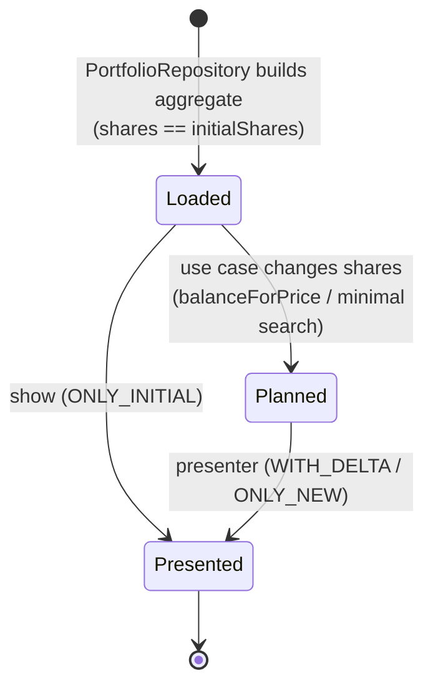

# Portfolio Allocation (core bounded context)

This context owns the rules for valuing a portfolio, measuring drift from target weights, computing whole-share allocations, and costing the trades between current and proposed holdings.

Code: `src/Entities` (model) and `src/UseCases` (application services; see [use-cases.md](use-cases.md)).

## Central idea: a portfolio is a plan

A `Portfolio` instance holds **two states at once** ([ADR-0010](../architecture/adr/0010-track-initial-state-in-entities.md)):

- the **initial** state, `initialShares`: what the investor holds now, fixed at construction, and
- the **proposed** state, `shares`: what the investor should hold, changed by use cases.

Everything about trades (traded shares, trade value, fees) is the difference between the two states. Prices are the same in both states, because a plan is made at a single point in time.



## Aggregate: `Portfolio`

**Aggregate root.** It's the only object use cases load and return, and it owns its `PortfolioSecurity` entities.

| Member | Meaning |
| --- | --- |
| `securities` | The holdings: one or more `PortfolioSecurity`. |
| `currency` | The single currency shared by all securities (taken from the first). |
| `totalPrice` | Σ security `totalPrice`: the value of the proposed state. |
| `initialTotalPrice` | Σ security `initialTotalPrice`: the value of current holdings. |
| `totalTradedPrice` | `totalPrice − initialTotalPrice`: net cash needed (positive) or released (negative). |
| `totalTradingFee` | Σ security `tradingFee`: the cost of all orders. |
| `cash` | Uninvested cash held now (≥ 0, default 0), from the settings file. |
| `deposit` | Money the plan adds (negative: withdraws). Set only by `allocateCash`; 0 otherwise. |
| `cashAfterTrades` | `cash + deposit − totalTradedPrice − totalTradingFee`: cash left once the plan is carried out. Negative means the plan needs that much more. |
| `balanceForPrice(price)` | **Domain operation.** For each security: `shares = round(price × targetPercentage ÷ securityPrice)` (rounded half-up by `Decimal.round()`). Throws `Portfolio price must be a finite number of at least 0 (<price>)` before changing anything if `price` is NaN, infinite or negative. |
| `allocateCash(deposit)` | **Domain operation** behind `invest` and `rebalance` ([ADR-0022](../architecture/adr/0022-plans-stay-within-available-cash.md)). It records `deposit` and runs `balanceForPrice(initialTotalPrice + cash + deposit)`. Then, while `cashAfterTrades < 0`, it removes one share from the most overweight security being **bought**, or from the most overweight holding once no buys are left. If selling everything still falls short, it stops there, and `cashAfterTrades` shows the shortfall. Throws `Deposit must be a finite number (<deposit>)`, or `Cannot withdraw <amount>: more than the portfolio value (<holdings + cash>)`. |
| `allocateValue(price)` | **Domain operation** behind `target`. It runs `balanceForPrice(price)`, then removes one share at a time from the most overweight holding until `totalPrice ≤ price`. |
| `clone()` | Deep copy through constructors, which re-validates. Not used by any command at the moment. |

### Invariants (checked at construction)

Only the proposed `shares` can change afterwards, and every change is checked. All other fields are read-only ([ADR-0021](../architecture/adr/0021-guard-proposed-shares.md)), so these invariants keep holding while use cases plan.

The constructor assigns the fields, runs decorator validation (P1, P4), then checks P2, P3 and P5 in that order.

| # | Invariant | Enforced by | Failure |
| --- | --- | --- | --- |
| P1 | At least one security | `@IsArray() @ArrayNotEmpty()` | `ClassValidatorError` (`arrayNotEmpty` on `securities`) |
| P2 | Target percentages sum to **exactly** 1 (`Decimal` equality) | constructor | `Error: Portfolio percentage don't add up to 1 (<sum>)` |
| P3 | All securities have the same currency | constructor | `Error: Portfolio have securities with different currencies` |
| P4 | Each security is itself valid | `@ValidateNested()` + each entity's own validation | `ClassValidatorError` |
| P5 | Ticks are unique | constructor | `Error: Portfolio has duplicate ticks (<ticks>)` |

## Entity: `PortfolioSecurity`

A holding of one security within a portfolio. It extends `Security`, so it carries the identity and the price quote. Its practical identity within the aggregate is its **tick**.

| Member | Meaning |
| --- | --- |
| `shares` / `initialShares` | Proposed and current whole-share counts. `initialShares` defaults to `shares`. |
| `targetPercentage` | Target weight in [0, 1]. |
| `brokerageFeeFlat`, `tradingFeePercentage`, `minimumTradingFeeFlat` | The fee tariff for this security's orders: the security's own value for each part it sets in the settings file, otherwise the portfolio's ([ADR-0020](../architecture/adr/0020-per-security-fee-overrides.md)). |
| `isBeingTraded` | `shares !== initialShares` |
| `totalPrice` / `initialTotalPrice` | `price × shares` / `price × initialShares` |
| `tradedPrice` | `totalPrice − initialTotalPrice` (signed: + buy, − sell) |
| `tradingFee` | See [fee model](#fee-model). |
| `calcActualPercentage(portfolioPrice, securityPrice = totalPrice)` | `securityPrice ÷ portfolioPrice`. Returns 0 instead of NaN when both are 0. |

### Invariants

| # | Invariant | Enforced by |
| --- | --- | --- |
| S1 | `shares`, `initialShares` are integers ≥ 0 | `@IsInt() @Min(0)` at construction; the `shares` setter on every later change ([ADR-0021](../architecture/adr/0021-guard-proposed-shares.md)) |
| S2 | `0 ≤ targetPercentage ≤ 1` | `@Min(0) @Max(1)` on getter |
| S3 | `brokerageFeeFlat ≥ 0`, `minimumTradingFeeFlat ≥ 0` | `@Min(0)` on getters |
| S4 | `0 ≤ tradingFeePercentage ≤ 1` | `@Min(0) @Max(1)` on getter |
| S5 | `tick` not empty, `price ≥ 0` | inherited from `Security` |

## `Security`

The tradable instrument plus its price at plan time: `tick`, `exchange?`, `isin?`, `price` (`Decimal`, ≥ 0), and `currency?`. It's never created directly, only as the base of `PortfolioSecurity`.

Conceptually it combines two things: an **instrument identity** (tick, exchange, ISIN), which would be a value object, and a **price quote** (price, currency), which is also a value object. The code doesn't separate them.

## Fee model

Per security (one order per traded security), from [ADR-0011](../architecture/adr/0011-fee-model-per-security-order.md) and [ADR-0020](../architecture/adr/0020-per-security-fee-overrides.md):

```
if not isBeingTraded:  tradingFee = 0
else:                  tradingFee = brokerageFeeFlat
                                  + max(tradingFeePercentage × |tradedPrice|, minimumTradingFeeFlat)
```

Portfolio total: `totalTradingFee = Σ tradingFee`.

`invest` and `rebalance` **budget** fees: `allocateCash` trims the plan until the trades and their fees fit in the cash held plus the deposit ([ADR-0022](../architecture/adr/0022-plans-stay-within-available-cash.md)). `target` keeps the holdings' value at or below the target, and reports the fees separately as cash spent on top.

The percentage applies to the order's absolute value, so a sell costs the same as a buy of the same value.

**Example.** Fees: flat 2, 0.2%, minimum 10. Buying 1,000 of a security costs `2 + max(2, 10) = 12`. Buying or selling 10,000 costs `2 + max(20, 10) = 22`.

## Measuring drift

A security's **drift** is `actualPercentage − targetPercentage`. The presenter shows both columns side by side, and `minimal` uses `|drift| ≤ precision` as its acceptance test. Actual percentage depends on which state is measured:

| View | Numerator | Denominator |
| --- | --- | --- |
| Current (`show`) | `initialTotalPrice` | portfolio `initialTotalPrice` |
| Proposed (`rebalance`, `invest`, `target`, `minimal`) | `totalPrice` | portfolio `totalPrice` |
| Trade only (`ONLY_DELTA`, no command uses it) | `abs(tradedPrice)` | Σ `abs(tradedPrice)` (gross traded value; 0 when nothing is traded) |

## Configuration (portfolio definition)

The **Portfolio Configuration** context provides the input for building the aggregate. The file `src/data/_settings.<TYPE>.jsonc` is validated against `SettingsDto`:

```jsonc
{
  "brokerageFeeFlat": 1,          // per order
  "tradingFeePercentage": 0,      // fraction of order value
  "minimumTradingFeeFlat": 0,     // floor for the percentage part
  "cash": 0,                      // optional: uninvested cash held, default 0
  "securities": [
    { "tick": "QDVE", "exchange": "IBIS2", "isin": "IE00B3WJKG14", "shares": 100, "targetPercentage": 0.4 },
    // its own flat fee; the parts it doesn't set fall back to the portfolio's
    { "tick": "SPYD", "exchange": "IBIS2", "isin": "IE00B6YX5D40", "shares": 100, "targetPercentage": 0.6,
      "brokerageFeeFlat": 3 }
  ]
}
```

The three portfolio-level fees are the default tariff. A security may set any of them, and each part it doesn't set falls back to the portfolio's on its own. An explicit `0` is an override. Unknown keys, such as a misspelled fee, are rejected.

`PortfolioRepository` combines each security's settings with its [price quote](market-data.md) and its fees (falling back to the portfolio's part by part) to build each `PortfolioSecurity`, then builds the `Portfolio`. That step is where invariants P1–P4 and S1–S5 are checked.

## Known gaps and open questions

These are behaviors of the current model that may not be intended. They're recorded here so they get decided deliberately.

1. **Security mixes identity and quote.** Quote time and source aren't recorded, so a plan can't say how fresh its prices are.
2. **Subclasses must validate themselves.** `validateClassErrors` only validates when `object.constructor === cls`. This is by design: the most-derived constructor validates once all fields are set (ADR-0004). A subclass that doesn't call it skips validation.
3. **Fees are in the portfolio's currency only.** Every fee value is read as an amount in the portfolio's single currency (P3). A broker fee quoted in another currency, such as 4 USD on a EUR portfolio, has to be entered as a hand-converted approximation (about 3.56 EUR). It drifts with the exchange rate, by cents. This is accepted: there's deliberately no currency conversion and no currency field on fees, because the portfolio is single-currency by design.
4. **One currency per portfolio.** P3 rejects a portfolio whose price quotes don't all share one currency. There's no FX conversion. A security listed in another currency only works if its quote arrives in the portfolio's currency, either from a source that quotes it that way or through a price override.
5. **No buy-only investing.** `invest` always rebalances too, so it can plan sells while money is being added. Each sell costs a fee and may have tax consequences. There's no option to only buy. See [UC-3](use-cases.md#uc-3-invest-an-additional-amount).
6. **No warning when fees eat into an order.** Plans report each order's fee but never judge it. With a flat fee, small orders are expensive in relative terms: 3 EUR on a 500 EUR buy is 0.6%, and splitting the same 500 EUR across three holdings costs three fees, about 1.8%. A warning when an order's fee exceeds a threshold (for example 1% of the order) would show when it's better to contribute less often in bigger amounts. Fees are accurate per security and for sells since [ADR-0020](../architecture/adr/0020-per-security-fee-overrides.md), so the fee share is meaningful.
