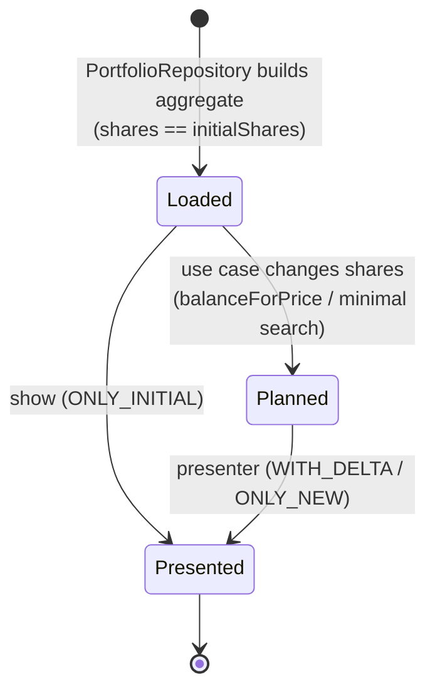

# Portfolio Allocation (core bounded context)

This context owns the rules for valuing a portfolio, measuring drift from target weights, computing whole-share allocations, and costing the trades between current and proposed holdings.

Code: `src/Entities` (model) and `src/UseCases` (application services; see [use-cases.md](use-cases.md)).

## Central idea: a portfolio is a plan

A `Portfolio` instance holds **two states at once** ([ADR-0010](../architecture/adr/0010-track-initial-state-in-entities.md)):

- the **initial** state, `initialShares`: what the investor holds now, fixed at construction, and
- the **proposed** state, `shares`: what the investor should hold, changed by use cases.

Everything about trades (traded shares, trade value, fees) is the difference between the two states. Prices are the same in both states, because a plan is made at a single point in time.



## Aggregate: `Portfolio`

**Aggregate root.** It's the only object use cases load and return, and it owns its `PortfolioSecurity` entities.

| Member | Meaning |
| --- | --- |
| `securities` | The holdings: one or more `PortfolioSecurity`. |
| `currency` | The single currency shared by all securities (taken from the first). |
| `totalPrice` | Σ security `totalPrice`: the value of the proposed state. |
| `initialTotalPrice` | Σ security `initialTotalPrice`: the value of current holdings. |
| `totalTradedPrice` | `totalPrice − initialTotalPrice`: net cash needed (positive) or released (negative). |
| `totalTradingFee` | Σ security `tradingFee`: the cost of all orders. |
| `cash` | Uninvested cash held now (≥ 0, default 0), from the settings file. |
| `feeWarningPercentage` | Fee share above which an order is flagged as expensive: a fraction in [0, 1] from the settings file, default 0.01 ([ADR-0024](../architecture/adr/0024-warn-about-expensive-orders.md)). |
| `expensiveOrders` | The planned orders whose `feeShare` is strictly above `feeWarningPercentage`. Information only: it never changes the plan. |
| `deposit` | Money the plan adds (negative: withdraws). Set only by `allocateCash`; 0 otherwise. |
| `cashAfterTrades` | `cash + deposit − totalTradedPrice − totalTradingFee`: cash left once the plan is carried out. Negative means the plan needs that much more. |
| `balanceForPrice(price)` | **Domain operation.** For each security: `shares = round(price × targetPercentage ÷ securityPrice)` (rounded half-up by `Decimal.round()`). Throws `Portfolio price must be a finite number of at least 0 (<price>)` before changing anything if `price` is NaN, infinite or negative. |
| `allocateCash(deposit)` | **Domain operation** behind `invest` and `rebalance` ([ADR-0022](../architecture/adr/0022-plans-stay-within-available-cash.md)). It records `deposit` and runs `balanceForPrice(initialTotalPrice + cash + deposit)`. Then, while `cashAfterTrades < 0`, it either cancels enough shares of one buy or sells the fewest more shares of a security already being sold, whichever leaves the weights closest to target. If no buys are left and `cash + deposit ≥ 0`, it plans no trades, because sells without buys would only cost fees. A withdrawal whose planned buys were all cancelled starts again from the holdings. A withdrawal that is still short sells the fewest shares of the holding that keeps the weights closest to target. Without buys, it then hands back sells it doesn't need. Sells whose fee is at least what they raise are dropped right after balancing. If nothing raises enough, `cashAfterTrades` shows the shortfall. Throws `Deposit must be a finite number (<deposit>)`, or `Cannot withdraw <amount>: more than the portfolio value (<holdings + cash>)`. |
| `buyWithCash(deposit)` | **Domain operation** behind `invest --buy-only` ([ADR-0023](../architecture/adr/0023-buy-only-investing.md)). It spends `cash + deposit` (which must be ≥ 0) on buys only. First it water-fills the underweight securities toward a common portfolio value, rounding to the nearest whole share. Then it cancels buys like `allocateCash` if that overshoots, and spends the remainder only on securities still at least half a share below target (most underweight first). Never sells, and never needs more than `cash + deposit`. |
| `allocateValue(price)` | **Domain operation** behind `target`. It runs `balanceForPrice(price)`, then removes one share at a time from the most overweight holding until `totalPrice ≤ price`. |
| `clone()` | Deep copy through constructors, which re-validates. Not used by any command at the moment. |

### Invariants (checked at construction)

Only the proposed `shares` can change afterwards, and every change is checked. All other fields are read-only ([ADR-0021](../architecture/adr/0021-guard-proposed-shares.md)), so these invariants keep holding while use cases plan.

The constructor assigns the fields, runs decorator validation (P1, P4), then checks P2, P3 and P5 in that order.

| # | Invariant | Enforced by | Failure |
| --- | --- | --- | --- |
| P1 | At least one security | `@IsArray() @ArrayNotEmpty()` | `ClassValidatorError` (`arrayNotEmpty` on `securities`) |
| P2 | Target percentages sum to **exactly** 1 (`Decimal` equality) | constructor | `Error: Portfolio percentage don't add up to 1 (<sum>)` |
| P3 | All securities have the same currency | constructor | `Error: Portfolio has securities in different currencies (<tick>: <currency>, …). Price them all in one currency, for example with a price override` |
| P4 | Each security is itself valid | `@ValidateNested()` + each entity's own validation | `ClassValidatorError` |
| P5 | Ticks are unique | constructor | `Error: Portfolio has duplicate ticks (<ticks>)` |

## Entity: `PortfolioSecurity`

A holding of one security within a portfolio. It extends `Security`, so it carries the identity and the price quote. Its practical identity within the aggregate is its **tick**.

| Member | Meaning |
| --- | --- |
| `shares` / `initialShares` | Proposed and current whole-share counts. `initialShares` defaults to `shares`. |
| `targetPercentage` | Target weight in [0, 1]. |
| `brokerageFeeFlat`, `tradingFeePercentage`, `minimumTradingFeeFlat` | The fee tariff for this security's orders: the security's own value for each part it sets in the settings file, otherwise the portfolio's ([ADR-0020](../architecture/adr/0020-per-security-fee-overrides.md)). |
| `isBeingTraded` | `shares !== initialShares` |
| `totalPrice` / `initialTotalPrice` | `price × shares` / `price × initialShares` |
| `tradedPrice` | `totalPrice − initialTotalPrice` (signed: + buy, − sell) |
| `tradingFee` | See [fee model](#fee-model). |
| `feeShare` | `tradingFee ÷ abs(tradedPrice)`: how much of the order goes to fees. 0 when not traded, or when the order has no value. |
| `calcActualPercentage(portfolioPrice, securityPrice = totalPrice)` | `securityPrice ÷ portfolioPrice`. Returns 0 instead of NaN when both are 0. |

### Invariants

| # | Invariant | Enforced by |
| --- | --- | --- |
| S1 | `shares`, `initialShares` are integers ≥ 0 | `@IsInt() @Min(0)` at construction; the `shares` setter on every later change ([ADR-0021](../architecture/adr/0021-guard-proposed-shares.md)) |
| S2 | `0 ≤ targetPercentage ≤ 1` | `@Min(0) @Max(1)` on getter |
| S3 | `brokerageFeeFlat ≥ 0`, `minimumTradingFeeFlat ≥ 0` | `@Min(0)` on getters |
| S4 | `0 ≤ tradingFeePercentage ≤ 1` | `@Min(0) @Max(1)` on getter |
| S5 | `tick` not empty, `price ≥ 0` | inherited from `Security` |

## `Security`

The tradable instrument and its price at plan time. It's never created directly, only as the base of `PortfolioSecurity`.

- Its **identity** is `tick`, `exchange?` and `isin?`.
- Its **`quote`** is a `PriceQuote` value object ([ADR-0025](../architecture/adr/0025-price-quotes-with-source-and-priority.md)): `price` (`Decimal`, ≥ 0), `currency?`, `source?` (`justetf.com`, `tradingview.com` or `override`) and `quotedAt?`. The quote validates itself.
- `Security.price` and `Security.currency` read from the quote, so a plan can say where each price came from and how fresh it is.

## Fee model

Per security (one order per traded security), from [ADR-0011](../architecture/adr/0011-fee-model-per-security-order.md) and [ADR-0020](../architecture/adr/0020-per-security-fee-overrides.md):

```
if not isBeingTraded:  tradingFee = 0
else:                  tradingFee = brokerageFeeFlat
                                  + max(tradingFeePercentage × |tradedPrice|, minimumTradingFeeFlat)
```

Portfolio total: `totalTradingFee = Σ tradingFee`.

`invest` and `rebalance` **budget** fees: `allocateCash` trims the plan until the trades and their fees fit in the cash held plus the deposit ([ADR-0022](../architecture/adr/0022-plans-stay-within-available-cash.md)). `target` keeps the holdings' value at or below the target, and reports the fees separately as cash spent on top.

The percentage applies to the order's absolute value, so a sell costs the same as a buy of the same value.

**Example.** Fees: flat 2, 0.2%, minimum 10. Buying 1,000 of a security costs `2 + max(2, 10) = 12`. Buying or selling 10,000 costs `2 + max(20, 10) = 22`.

## Measuring drift

A security's **drift** is `actualPercentage − targetPercentage`. The presenter shows both columns side by side, and `minimal` uses `|drift| ≤ precision` as its acceptance test. Actual percentage depends on which state is measured:

| View | Numerator | Denominator |
| --- | --- | --- |
| Current (`show`) | `initialTotalPrice` | portfolio `initialTotalPrice` |
| Proposed (`rebalance`, `invest`, `target`, `minimal`) | `totalPrice` | portfolio `totalPrice` |
| Trade only (`ONLY_DELTA`, no command uses it) | `abs(tradedPrice)` | Σ `abs(tradedPrice)` (gross traded value; 0 when nothing is traded) |

## Configuration (portfolio definition)

The **Portfolio Configuration** context provides the input for building the aggregate. The file `<broker>/<portfolio>.jsonc` is validated against `SettingsDto`, with the fee settings it leaves out taken from the broker's optional `_broker.jsonc` ([ADR-0027](../architecture/adr/0027-portfolios-grouped-by-broker.md)). Every fee part is optional; one set nowhere is 0:

```jsonc
{
  "brokerageFeeFlat": 1,          // per order
  "tradingFeePercentage": 0,      // fraction of order value
  "minimumTradingFeeFlat": 0,     // floor for the percentage part
  "cash": 0,                      // optional: uninvested cash held, default 0
  "feeWarningPercentage": 0.01,   // optional: flag orders whose fee is above 1% of their value
  "securities": [
    { "tick": "QDVE", "exchange": "IBIS2", "isin": "IE00B3WJKG14", "shares": 100, "targetPercentage": 0.4 },
    // its own flat fee; the parts it doesn't set fall back to the portfolio's
    { "tick": "SPYD", "exchange": "IBIS2", "isin": "IE00B6YX5D40", "shares": 100, "targetPercentage": 0.6,
      "brokerageFeeFlat": 3 }
  ]
}
```

The three portfolio-level fees are the default tariff. A security may set any of them, and each part it doesn't set falls back to the portfolio's on its own. An explicit `0` is an override. Unknown keys, such as a misspelled fee, are rejected.

`PortfolioRepository` combines each security's settings with its [price quote](market-data.md) and its fees (falling back to the portfolio's part by part) to build each `PortfolioSecurity`, then builds the `Portfolio`. That step is where invariants P1–P4 and S1–S5 are checked.

## Known gaps and open questions

None open. Every gap recorded here has been resolved or decided. New ones go here, numbered, until they are.

## Decided limitations

These are deliberate. Changing them needs a new decision record, not a fix.

- **One currency per portfolio, with fees in that currency** ([ADR-0026](../architecture/adr/0026-single-currency-portfolios.md)). P3 rejects a portfolio whose quotes don't share one currency, and names each security's currency. A security listed in another currency needs a price in the portfolio's currency, from a source or an override. A fee quoted in another currency is entered converted by hand (4 USD ≈ 3.56 EUR), so it drifts with the exchange rate by cents. There's no FX conversion and no fee currency field.
- **Withdrawals choose what to sell by weights, not fees** ([ADR-0022](../architecture/adr/0022-plans-stay-within-available-cash.md)). When holdings have very different fees, a withdrawal can sell where the order costs more, for example paying a 10 minimum fee when a fee-free holding would have covered it. The fee warning points such orders out.
- **Only the most-derived class validates** ([ADR-0004](../architecture/adr/0004-self-validating-entities.md)). `validateClassErrors` only runs when `object.constructor === cls`, so every class with validation decorators, and every subclass of one, must call it on itself. `src/__tests__/validationGuard.test.ts` scans `src` and fails when a class doesn't.
